# Historical EDA: Olist marketplace (real data)

> **Scope.** This report describes real historical Olist orders. Every finding is
> **observational**: it describes what happened and what moved together, not what
> caused what. Olist has no website sessions or checkout attempts, so nothing here is a
> conversion rate.
>
> **Reproduce:** `uv run python -m marketplace_analytics eda`. All numbers below come
> from `reports/results/eda/*.csv` and `key_numbers.json`, produced from the Kaggle
> archive with SHA-256 `967e41e0…6deca784`. Charts are in `reports/figures/eda/`.
> Before any output is written, 40 key metrics are recomputed independently in pandas
> from the raw CSVs and checked against SQL. **40/40 match exactly.**

**Population conventions.** Unless stated otherwise:

- Analysis window: purchases from 2017-01-01 to 2018-08-31 (99,092 orders).
- Value metrics use `delivered` orders.
- Delivery metrics use *measurable* deliveries (status `delivered` with a
  customer-delivery timestamp; 96,203 orders).
- Review metrics use the latest review per order.
- Money is BRL paid by customers. It is not Olist revenue.

## 1. Summary for the business

1. **The marketplace grew, then plateaued.** Monthly orders rose from 800 (Jan 2017)
   to a peak of 7,544 (Nov 2017), then held around 6,100–7,300 per month through 2018.
2. **Order value is steady and skewed.** AOV (mean gross value per delivered order) is
   **R$159.79**, but the median is **R$105.28** and the 90th percentile R$305.69.
   Monthly AOV stayed between R$146 and R$170. Freight averages 20.9% of an order's
   gross value.
3. **Credit cards dominate.** They carry 78.4% of payment value, and two thirds
   (66.8%) of credit-card payments are split into more than one instalment. Boleto
   (bank slip) carries 17.9%.
4. **Most orders arrive early, but lateness comes in waves.** 6.8% of measurable
   deliveries arrived after the promised date. The monthly rate ranged from 1.2%
   (Jun 2018) to 18.9% (Mar 2018), with peaks in Nov 2017 (12.4%) and Feb–Mar 2018.
5. **Late delivery is strongly associated with bad reviews.** Even counting only
   customers whose survey arrived after the parcel, the low-review rate is 25.1% for
   late orders vs 9.2% for on-time ones. The naive comparison (62.4% vs 9.2%) mostly
   reflects surveys sent before the order arrived (§3.3).
6. **Regional differences are large.** Northeast customers saw the highest late rate
   (12.8% vs 6.1% in the Southeast), and North customers the slowest median delivery
   (20.2 days vs 8.7).

## 2. Descriptive analysis

### 2.1 Volume and value

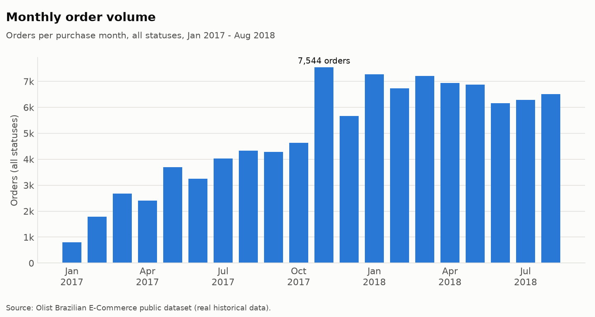
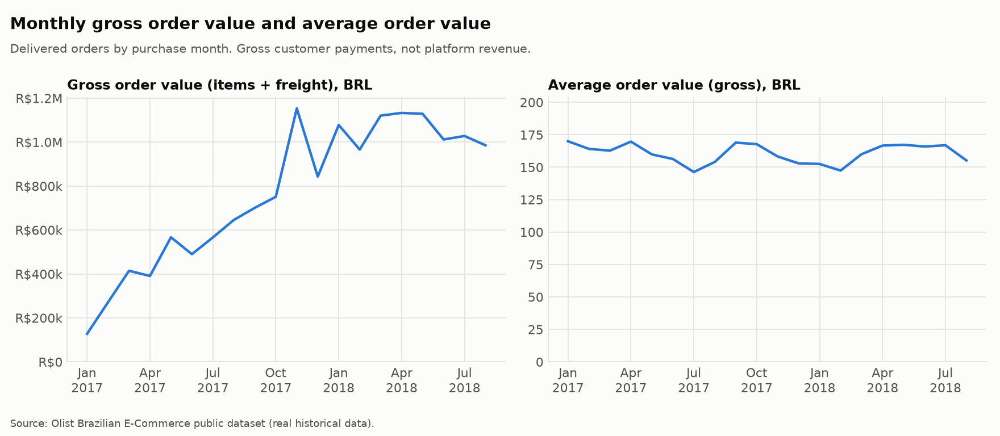

| Metric (analysis window) | Definition | Value |
|---|---|---:|
| Orders (all statuses) | count of orders | 99,092 |
| Delivered orders | status `delivered` | 96,211 |
| Gross merchandise value (GMV) | Σ item prices, delivered | R$13,181,027 |
| Freight | Σ freight, delivered | R$2,192,093 |
| Gross order value | GMV + freight, delivered | R$15,373,120 |
| Payment value | Σ payments, **all statuses** | R$15,944,481 |
| AOV | gross order value / delivered orders | R$159.79 |
| Median gross order value | delivered | R$105.28 |

Payment value is higher than delivered gross order value because it includes orders
that were never delivered. It also includes R$155,483 paid on orders that have **no
items at all** (§3.4).

The Nov 2017 peak coincides with Black Friday (24 Nov 2017). The data cannot confirm
that the promotion caused the peak.

### 2.2 Order status

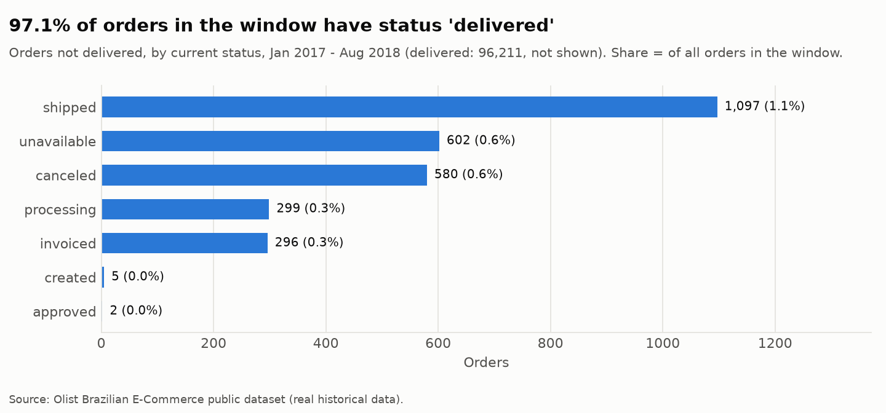

97.1% of orders in the window are `delivered`. The rest are `shipped` (1.1%),
`unavailable` (0.6%), `canceled` (0.6%), `processing` and `invoiced` (0.3% each).
Statuses are a **snapshot** taken when the dataset was extracted, so a `shipped` order
may have been delivered later.

### 2.3 Payments and instalments

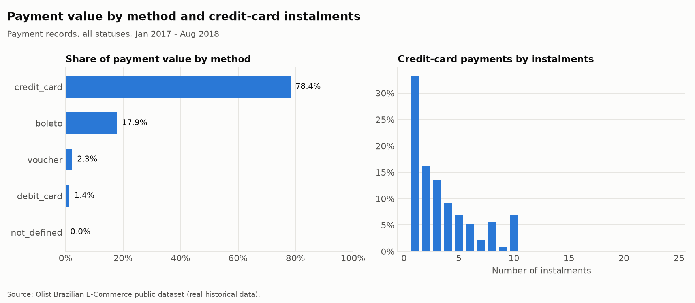

| Method | Value share | Orders using it | Mean instalments |
|---|---:|---:|---:|
| credit_card | 78.4% | 76,248 | 3.5 |
| boleto | 17.9% | 19,721 | 1.0 |
| voucher | 2.3% | 3,836 | 1.0 |
| debit_card | 1.4% | 1,526 | 1.0 |

An order can use several methods, so the order counts overlap. Among credit-card
payment records, 33.2% are single-instalment. There are visible spikes at 8 and 10
instalments, which looks like common instalment offers (an interpretation, not
something in the data). Larger payments use more instalments: the mean payment is
R$95.89 at 1 instalment and R$414.79 at 10.

### 2.4 Delivery performance

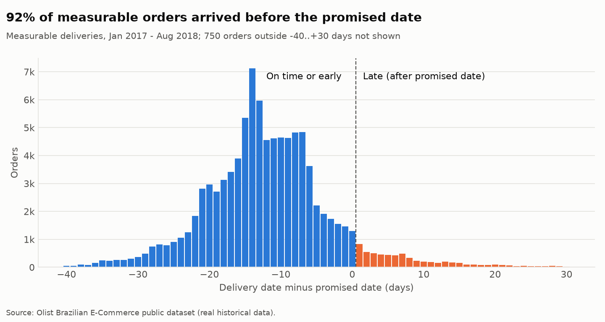
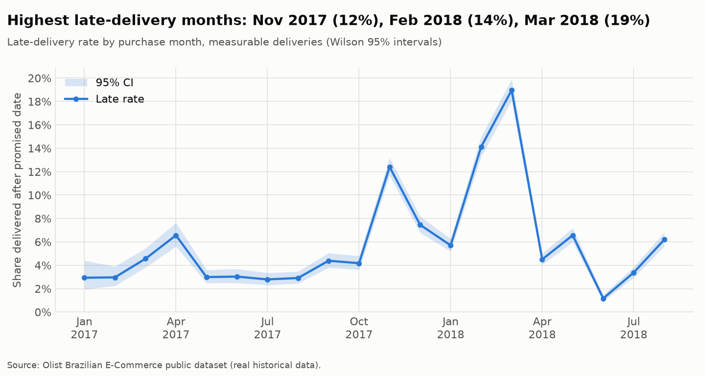

- 92% of measurable deliveries arrived **before** the promised date. The estimate is
  conservative (median 12 days early).
- Late-delivery rate: **6.79%** (6,531 of 96,203). It depends on the definition:
  comparing the delivery *timestamp* with the promised date at 00:00 gives **8.13%**,
  because 1.34% of orders arrive *on* the promised day. This project uses the
  date-level definition, since the promise is a calendar date.
- The monthly late rate varies far more than sampling noise would explain. The 95%
  Wilson intervals do not overlap between quiet months (~3%) and Feb–Mar 2018
  (14–19%). Operational causes (carrier capacity, weather, strikes) are plausible
  but **not observable** in this data.

### 2.5 Reviews

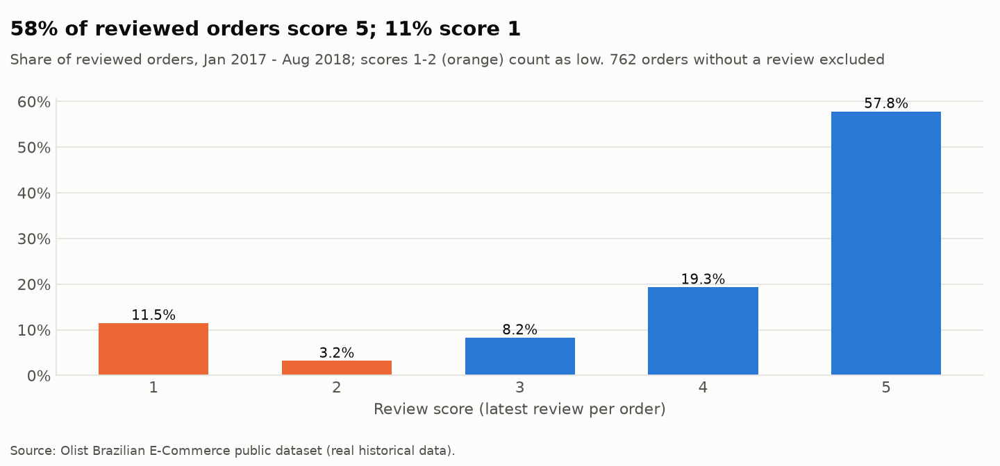

Reviews are polarised: 57.8% score 5 and 11.5% score 1, while 3 is uncommon (8.2%).
Low reviews (1–2) make up 14.7% of reviewed orders. Of orders in the window, 762 have
no review and are left out of review denominators.

Orders that never reached the customer are reviewed very badly. The low-review rate
is 69.6% for `shipped`, 76.9% for `canceled`, 84.9% for `unavailable` and 92.9% for
`processing`, against 12.8% for `delivered` (all orders with a review).

### 2.6 Delivery delay and reviews (observational)

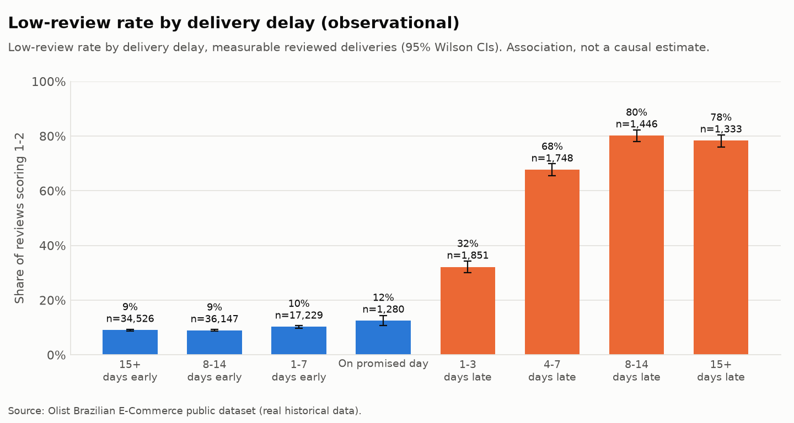

| Delivery vs promise | Reviewed orders | Low-review rate (95% CI) |
|---|---:|---|
| 15+ days early | 34,526 | 9.0% (8.7–9.3) |
| 8–14 days early | 36,147 | 8.9% (8.6–9.2) |
| 1–7 days early | 17,229 | 10.2% (9.8–10.7) |
| On promised day | 1,280 | 12.4% (10.7–14.3) |
| 1–3 days late | 1,851 | 32.1% (30.1–34.3) |
| 4–7 days late | 1,748 | 67.7% (65.5–69.8) |
| 8–14 days late | 1,446 | 80.2% (78.0–82.1) |
| 15+ days late | 1,333 | 78.3% (76.0–80.4) |

The rate is flat while orders arrive early and jumps once the promise is missed. That
fits customers judging delivery against the promise rather than against absolute
speed. But §3.3 shows that the late buckets are dominated by surveys answered before
the order arrived, so this table should not be read as "how much one extra day late
lowers satisfaction".

### 2.7 Categories and regions

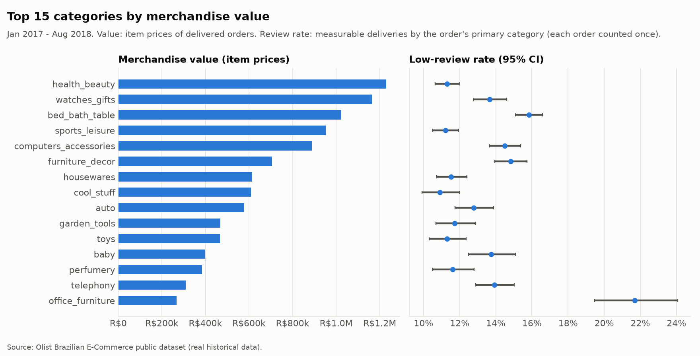
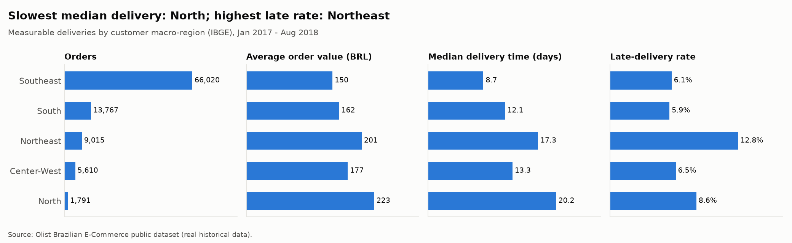

- The top categories by merchandise value are health_beauty (R$1.23M), watches_gifts
  (R$1.16M) and bed_bath_table (R$1.02M).
- Among the top 15, office_furniture has the highest low-review rate (21.7%, CI
  19.5–24.1%) and also the highest freight share (20.0%). bed_bath_table (15.8%) and
  furniture_decor (14.8%) also sit above the 11–12% typical of health_beauty,
  sports_leisure and housewares. Category is tangled up with product size, freight
  and seller location, so these are not category effects.
- **Regions.** Value metrics are by customer macro-region:

  | Region | Orders | AOV | Median delivery | Late rate | Low-review rate |
  |---|---:|---:|---:|---:|---:|
  | Southeast | 66,020 | R$150 | 8.7 d | 6.1% | 12.4% |
  | South | 13,767 | R$162 | 12.1 d | 5.9% | 11.8% |
  | Northeast | 9,015 | R$201 | 17.3 d | 12.8% | 16.8% |
  | Center-West | 5,610 | R$177 | 13.3 d | 6.5% | 13.1% |
  | North | 1,791 | R$223 | 20.2 d | 8.6% | 15.2% |

  North customers wait longest, but they are also *promised* the longest (38 days on
  average), so their late rate (8.6%) is lower than the Northeast's (12.8%).
  Customers far from the Southeast seller base pay higher order values and a larger
  freight share (28.4% in the North vs 19.5% in the Southeast).

## 3. Data-quality investigations

### 3.1 The 6.8% late-delivery rate

| Population step | Orders | Late rate (date) | Late rate (timestamp) |
|---|---:|---:|---:|
| All orders | 99,441 | | |
| Status `delivered` | 96,478 | | |
| Delivered with delivery timestamp | 96,470 | 6.77% | 8.11% |
| … and in analysis window (**headline**) | 96,203 | **6.79%** | 8.13% |
| Excluded: not delivered but has a delivery timestamp | 6 | | |
| Excluded: delivered without a delivery timestamp | 8 | | |

**Confirmed.** The figure is computed on a clearly defined population, and the
exclusions are tiny (14 orders). Undelivered orders (`shipped`, `canceled`, …) have no
measurable delivery, so the true share of customers who did not get their order on
time is **understated** by this metric. That is a selection effect worth stating
alongside the 6.8%.

### 3.2 Low reviews: late vs on-time

| Population | Late: low / reviewed | On time: low / reviewed | Difference (95% Newcombe CI) | Risk ratio |
|---|---|---|---|---:|
| All measurable reviewed deliveries | 62.4% (3,981 / 6,378) | 9.2% (8,247 / 89,182) | +53.2 pp (52.0 to 54.4) | 6.7 |
| Survey sent on/after delivery date | 25.1% (409 / 1,629) | 9.2% (8,208 / 88,961) | +15.9 pp (13.8 to 18.1) | 2.7 |

Both differences are far beyond sampling noise (pooled z-test p < 1e-15). Statistical
significance is not the interesting part, though. **The size of the gap depends
heavily on survey timing**, because 74% of late orders (4,749 of 6,378) had their
survey sent before the parcel arrived. The restricted comparison is the cleaner view
of how customers rated an order they actually received late.

Neither comparison is causal. Late orders differ systematically in region, product
size, seller and season. Milestone 3 addresses this with a regression on a population
defined with this timing in mind.

### 3.3 The 4,976 "reviewed before delivery" orders

Milestone 1 flagged these as reviews created before delivery. Checking the Olist field
definitions corrected that: `review_creation_date` is **the date the satisfaction
survey was sent** (date-only), and `review_answer_timestamp` is when the customer
answered. The flag is now `survey_sent_before_delivery`, with a separate
`answered_before_delivery`.

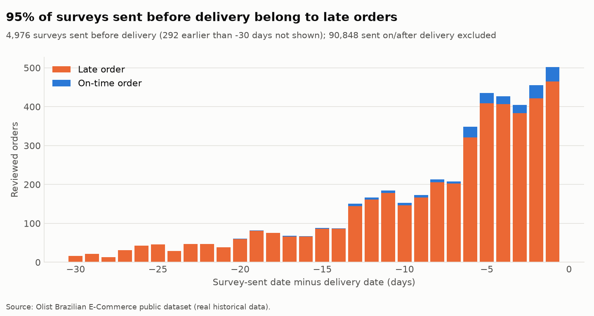

What the data shows (measurable reviewed deliveries):

- For 85,320 orders (89%), the survey was sent the day after delivery, which is the
  normal pattern.
- For 4,976 orders, the survey was sent before the delivery date. Of these:
  - **95.5% are late orders.**
  - 4,697 (94.4%) were sent **on or after the promised date**.
  - 4,452 were also *answered* before the parcel arrived.
  - **72.6% of them are low reviews**, rising to 81.6% (3,447 / 4,224) for late orders
    whose survey was sent after the promise and answered before delivery.

**What can be inferred.** The data is consistent with surveys being triggered by
delivery or by the promised date passing, whichever comes first. A customer whose
order is overdue gets a survey about a parcel they do not have yet, and many answer
it negatively. This is a property of **how the measurement is taken**, not a separate
behavioural effect. It also means the review score for these orders mixes "the order
is late" with "I haven't received it yet".

**What cannot be inferred.** Olist's actual survey logic is not documented in the
data, so the trigger rule above is a hypothesis. 279 surveys were sent before *both*
the delivery date and the promised date, which the hypothesis does not explain. 225
of those belong to on-time orders. Their low-review rate is 17% (39 / 225), and the
data does not show why the survey came early.

**Implication.** Any analysis of review scores must state whether it includes
pre-delivery surveys. Milestone 3 will model the low-review outcome on a population
defined with this in mind, and report sensitivity to including them.

### 3.4 Payments vs items + freight

Compared in **exact integer cents** (DECIMAL arithmetic) over the 98,665 orders that
have both items and payments:

| Class | Orders | Net difference | Median | Instalments > 1 | Multi-item |
|---|---:|---:|---:|---:|---:|
| Exact match | 98,089 | R$0.00 | R$0.00 | 51.4% | 9.7% |
| 1 cent apart | 273 | −R$0.67 | −R$0.01 | 63.4% | **100%** |
| Paid more | 264 | +R$3,070.14 | +R$6.49 | **94.3%** | 15.9% |
| Paid less | 39 | −R$199.08 | −R$0.04 | 51.3% | 64.1% |

**Correction to Milestone 1.** The "387 orders" reported there came from a
floating-point comparison in an ad-hoc profiling script. With exact arithmetic, 576
orders differ: 273 by exactly 1 cent and 303 by more.

- **1-cent differences** occur *only* in multi-item orders. That fits per-item
  rounding when an order total is split across lines. This is an inference, but a
  strong one.
- **Overpayments** (median R$6.49) are concentrated in instalment payments: 94% vs 51%
  for exact matches, and 95% are credit card. This fits instalment interest or card
  fees being included in `payment_value`. The data has no field to confirm it.
- **Underpayments** are small (median 4 cents, total R$199) and unexplained. They are
  not voucher-related (0% use vouchers).
- **Separately, 775 orders have payments but no items** (R$162,591.95 all time; 603
  `unavailable`, 164 `canceled`). Their payments are counted in payment value, which
  is why payment value and GMV-based metrics must not be mixed. One delivered order
  has items but no payment record.

None of these are hidden. The warehouse keeps `items_value`, `freight_value` and
`payment_value` side by side, and each metric states which one it uses.

## 4. Limitations

- **Observational only.** No finding here identifies a cause.
- **Status is a snapshot**, and undelivered orders are left out of delivery metrics.
  The late rate describes delivered orders only.
- **Reviews are selective.** Customers choose whether to answer, and survey timing
  varies with lateness (§3.3).
- **Values are customer payments in nominal BRL**, not inflation-adjusted and not
  platform revenue. Olist's commission is unknown.
- **Product categories** come from product metadata; 610 products have no category
  (`unknown`).
- **No funnel data.** The dataset cannot say how many people *tried* to buy, which is
  why the checkout experiment (Phase C) is simulated.

## 5. Questions for later milestones

1. **Milestone 3 (regression).** How strongly is delay associated with a low review
   once region, category, freight, order value, item count and seller count are held
   constant? How do the results change with and without pre-delivery surveys?
2. **Milestone 3 (hypothesis test).** Is the late vs on-time gap in low reviews
   robust within regions (stratified analysis)?
3. **Milestone 4 (simulation).** Use realistic, data-informed parameters for the
   simulated experiment, such as AOV skew (median ≪ mean) and the payment-method
   mix, while keeping the simulation clearly labelled.
4. **Milestone 6 (Power BI).** The payment-value vs GMV distinction and the survey
   timing flag need explicit, separately labelled measures.
