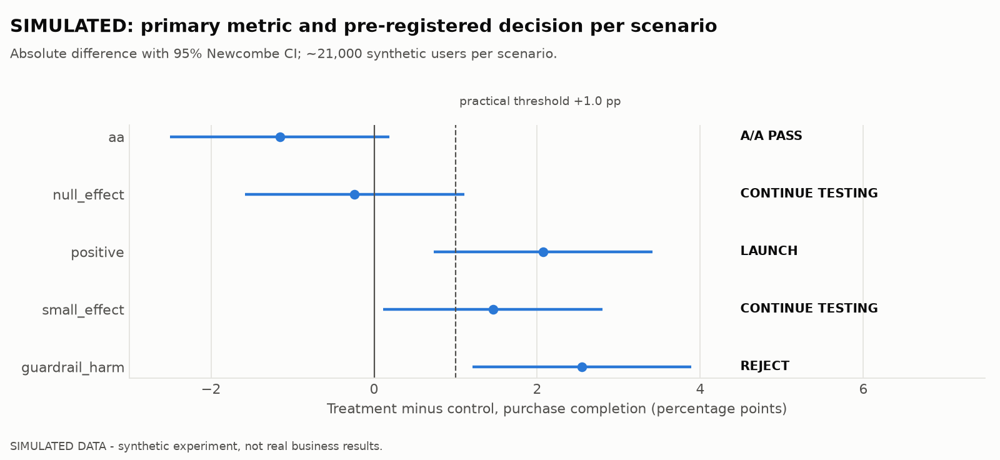
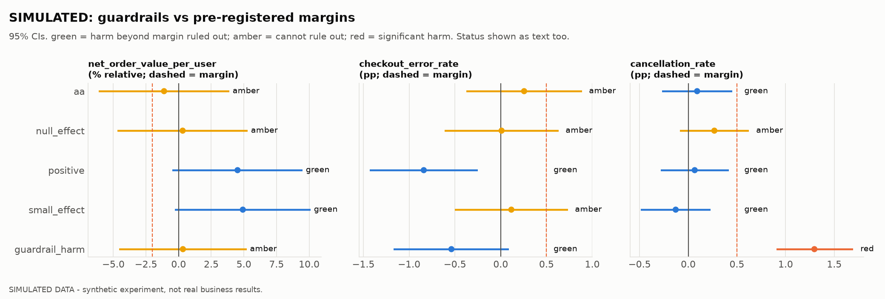
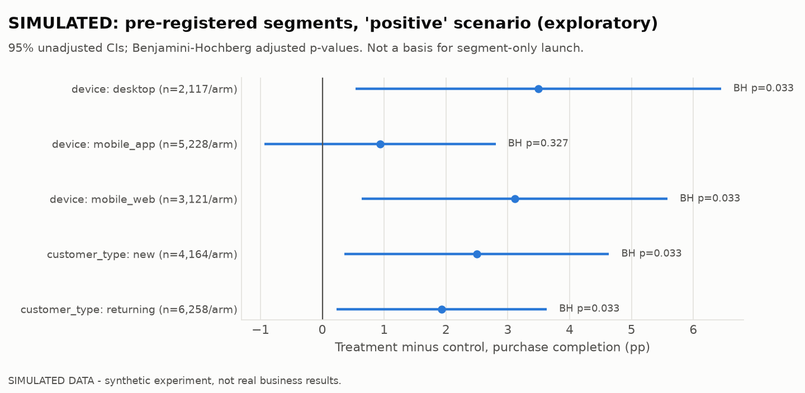
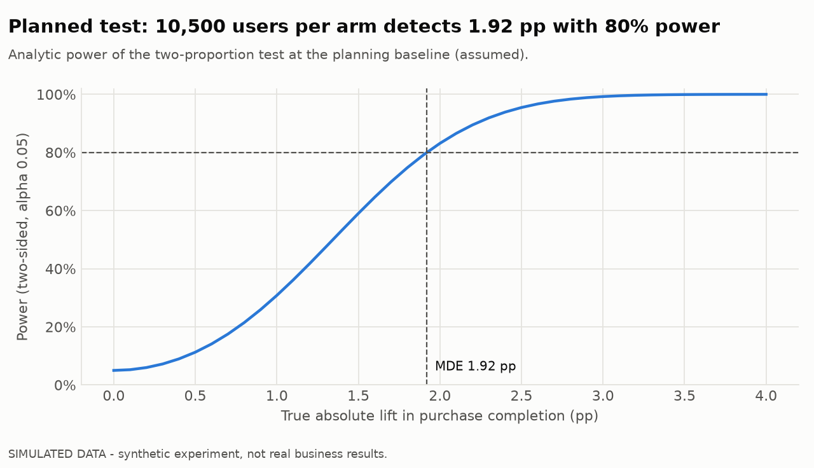
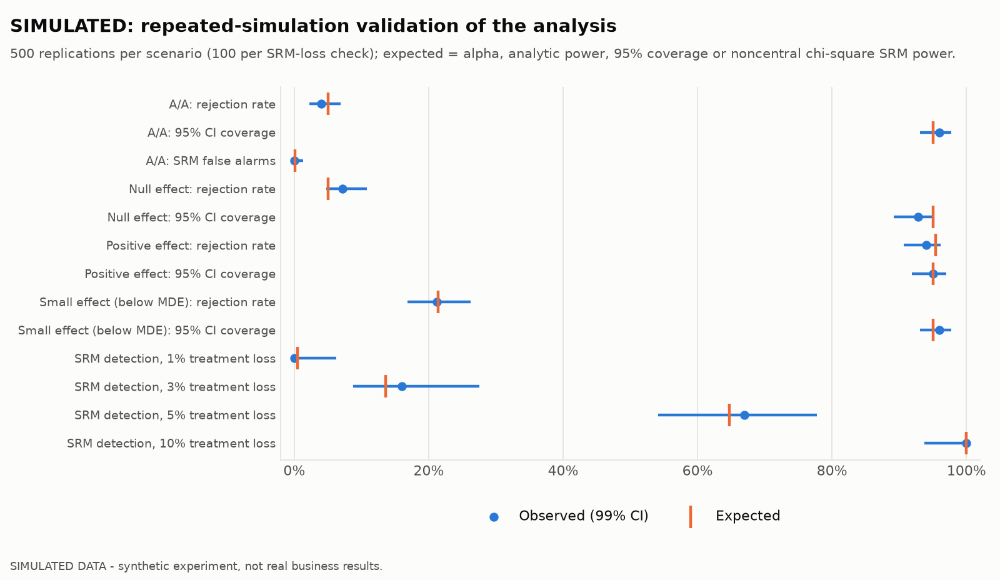
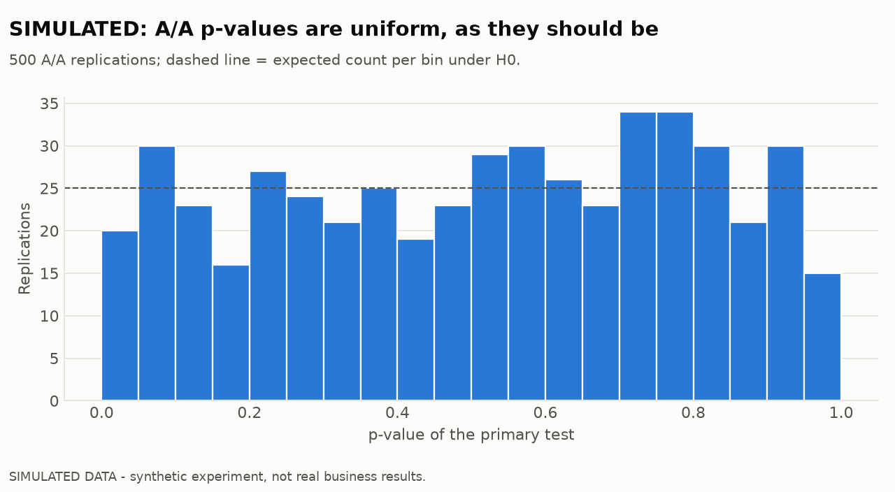

# Simplified checkout A/B test: SIMULATED results

> ⚠️ **SIMULATED DATA. These are not business results.** Every user, assignment and
> outcome below was generated by `experiments/simulate.py` from the assumptions in
> [docs/experiment_plan.md](../docs/experiment_plan.md). Olist has no checkout or
> session data, and nothing here estimates the real effect of a checkout change at
> Olist, Vinted or anywhere else. The purpose is to show **how** such a test is
> designed, validated, analysed and decided.
>
> **Reproduce:** `uv run python -m marketplace_analytics experiment`. Tables are in
> `reports/results/experiment/` and the DuckDB `sim` schema, and charts are in
> `reports/figures/experiment/`. Seeds are fixed, so the numbers below are exactly
> reproducible.

## 1. Design in one paragraph

Eligible users (anyone who opens the checkout during a 14-day window) are assigned
50/50 by a deterministic hash of their user id. The **primary metric** is purchase
completion within 7 days, per assigned user. The plan pre-registers:

- α = 0.05 two-sided, 80% power and an MDE of 2.0 pp (9,669 users per arm needed;
  10,500 planned, giving an achieved MDE of **1.92 pp**),
- a practical threshold of +1.0 pp,
- three non-inferiority guardrails: net order value per user ≤ −2% relative; checkout
  errors and cancellations ≤ +0.5 pp each,
- an SRM alarm at p < 0.001,
- the decision rules in §6 of the plan.

Five independent worlds were simulated. The analysis sees only observed data, and the
true effects are revealed in §5 for comparison.

## 2. Results and decisions by scenario

All scenarios passed the five data-quality checks and the SRM check (p ≥ 0.20). SQL and
Python metrics reconcile exactly.

### Primary metric: purchase completion

| Scenario | Control | Treatment | Δ (95% CI), pp | Relative Δ | p | Decision |
|---|---|---|---|---|---:|---|
| `aa` | 55.71% of 10,516 | 54.55% of 10,484 | −1.16 (−2.50 to +0.19) | −2.1% | 0.092 | **A/A PASS** |
| `null_effect` | 54.91% of 10,446 | 54.67% of 10,554 | −0.24 (−1.59 to +1.11) | −0.4% | 0.73 | **CONTINUE TESTING** |
| `positive` | 55.11% of 10,528 | 57.18% of 10,472 | **+2.07 (+0.73 to +3.41)** | +3.8% (+1.3 to +6.3) | 0.0025 | **LAUNCH** |
| `small_effect` | 53.89% of 10,456 | 55.35% of 10,544 | +1.46 (+0.11 to +2.80) | +2.7% | 0.034 | **CONTINUE TESTING** |
| `guardrail_harm` | 54.84% of 10,408 | 57.39% of 10,592 | +2.55 (+1.21 to +3.89) | +4.7% | 0.0002 | **REJECT** |

### Guardrails (95% CI vs margin)

| Scenario | Net order value / user (relative) | Checkout errors (pp) | Cancellations (pp) |
|---|---|---|---|
| `aa` | −1.1% (−6.1 to +3.9) amber | +0.26 (−0.37 to +0.89) amber | +0.09 (−0.27 to +0.45) green |
| `null_effect` | +0.3% (−4.7 to +5.3) amber | +0.01 (−0.61 to +0.63) amber | +0.27 (−0.08 to +0.62) amber |
| `positive` | +4.5% (−0.5 to +9.5) green | −0.84 (−1.43 to −0.25) green | +0.07 (−0.28 to +0.42) green |
| `small_effect` | +4.9% (−0.3 to +10.1) green | +0.12 (−0.50 to +0.73) amber | −0.13 (−0.49 to +0.23) green |
| `guardrail_harm` | +0.3% (−4.6 to +5.2) amber | −0.54 (−1.17 to +0.09) green | **+1.30 (+0.91 to +1.69) red** |

Descriptive secondary metrics. These are conditional on purchase, so they are not
randomised comparisons:

- **Checkout time** (geometric mean) is lower in every treated scenario: −9.9% in
  `null_effect`, −16.3% in `positive`, −16.0% in `guardrail_harm`.
- **AOV among purchasers** moved −2.1% (−6.1 to +1.9) in `guardrail_harm` and within
  ±2% elsewhere.

### What each decision means

- **`aa`: A/A PASS.** There was no significant primary difference and no SRM. This is
  a system check, not a product decision. The −1.16 pp gap is pure chance, a reminder
  of how large noise is at this sample size.
- **`null_effect`: CONTINUE TESTING (inconclusive).** The CI of −1.59 to +1.11 pp
  includes zero but also includes +1 pp, a lift worth launching. **This is not
  evidence of no effect.** The test cannot tell "nothing" from "a small worthwhile
  win". The recommended next step is to **not launch on this evidence**. If a 1–2 pp
  lift would still justify the work, run a *new* pre-registered test sized for 1 pp:
  about 39,000 users per arm, 4× this one. The faster checkout (−10%) is real but is
  not the goal metric.
- **`positive`: LAUNCH.** Completion rose +2.07 pp (CI +0.73 to +3.41). The estimate
  exceeds the 1 pp threshold and all three guardrails ruled out harm beyond their
  margins. Note that the CI lower bound (+0.73 pp) is below the practical threshold,
  so a modest real lift is plausible. Revenue per user cleared its margin only because
  more users bought (lower bound −0.5% vs a −2% margin).
- **`small_effect`: CONTINUE TESTING.** The primary result is statistically
  significant, but the checkout-error guardrail is amber (+0.12 pp, CI up to +0.73 vs
  a 0.5 pp margin). The rules therefore do not allow a launch.
- **`guardrail_harm`: REJECT.** The treatment sold more (+2.55 pp) but cancellations
  rose by +1.30 pp, with the whole CI beyond the 0.5 pp margin. A primary win does not
  override a breached guardrail.

## 3. Pre-registered segments (exploratory)

In `positive`, four of the five segment estimates are significant after the
Benjamini–Hochberg correction (BH p = 0.033). The fifth, mobile_app, is +0.93 pp
(−0.94 to +2.80, BH p = 0.33). It would be tempting to conclude that the new checkout
"doesn't work in the app". **In the simulation the true effect is identical (+2.5 pp)
in every segment**, so that apparent difference is pure noise. That is exactly why
segment results are labelled exploratory and never used for segment-only launches.

In the **A/A** scenario, 2 segment tests reach p < 0.05 before correction and none
after it. That is the multiple-testing problem, and the correction handling it, in one
table.

## 4. Power and what this test can and cannot detect

- With 10,500 users per arm the test detects **1.92 pp with 80% power**. Its power is
  only about 31% at the 1.0 pp practical threshold.
- **Guardrail sensitivity was under-planned.** The guardrail margins were fixed before
  analysis, but their power was not checked. Using the A/A control arm as a stand-in
  for pre-period data:

| Guardrail | Margin | Expected 95% CI half-width at 10,500/arm | Users/arm needed to show non-inferiority (80%) |
|---|---|---|---:|
| Net order value / user | 2% (= 1.74 per user) | ±4.25 per user | **127,770** |
| Checkout error rate | 0.5 pp | ±0.62 pp | **33,309** |
| Cancellation rate | 0.5 pp | ±0.36 pp | 10,854 |

  As planned, the revenue and error guardrails are **green only when the treatment
  happens to move them in the favourable direction**. Under a true zero effect they
  will usually be amber. That is why `aa` and `null_effect` show amber guardrails.
  The pre-registered rules were applied unchanged. Loosening the margins after seeing
  results would be p-hacking. The fix belongs in the **next** test's plan: either
  power the guardrails (larger sample or variance reduction such as CUPED on
  pre-period spend), or state explicitly that revenue is a "no significant harm"
  monitor rather than a non-inferiority gate.

## 5. Validating the method (repeated simulation)

There were 500 full simulate-and-analyse runs per scenario, and 100 for each SRM-loss
level. The observed rates are compared with their theoretical values using 99%
tolerance intervals. **All 13 checks are consistent.**

| Check | Observed | Expected |
|---|---:|---:|
| A/A false-positive rate | 4.0% | 5% |
| Null-effect false-positive rate | 7.2% (99% CI 4.8–10.8) | 5% |
| Power, positive (+2.5 pp) | 94.0% | 95.4% (analytic) |
| Power, small effect (+0.8 pp) | 21.2% | 21.4% (analytic) |
| 95% CI coverage (four scenarios) | 92.8–96.0% | 95% |
| SRM false alarms (A/A) | 0.0% | 0.1% |
| SRM detection: 1% / 3% / 5% / 10% treatment logging loss | 0% / 16% / 67% / 100% | 0.5% / 13.6% / 64.8% / 100% |

- The mean estimate across replications equals the true effect (positive: +2.49 vs
  +2.5 pp; small: +0.79 vs +0.8 pp), so the estimator is **unbiased**.
- **Small effects are found rarely and overstated when found.** A +0.8 pp effect is
  detected only about 21% of the time. The single `small_effect` run shown in §2
  happened to be one of those detections, and it estimated +1.46 pp, almost twice the
  truth. That is the "winner's curse" of underpowered tests. The rules did not launch
  it, but only because a guardrail was amber.
- **SRM checks miss small logging losses.** At this sample size, losing 3% of treatment
  users is caught only about 1 time in 7. An SRM pass is not proof of clean logging.

## 6. Limitations

- **Simulated world.** Outcomes are independent given device and customer type: errors
  don't cause abandonment, effects are constant across segments, and there are no
  novelty effects, day-of-week patterns or interference between buyers and sellers.
  Real checkouts have all of these. A marketplace may also need cluster or switchback
  designs.
- **Assumed parameters.** Baselines, effects and variances are inputs, not
  measurements.
- **Single analysis.** The fixed horizon assumes no peeking. Sequential monitoring
  would need always-valid methods.
- **Short-term metrics only.** There is no retention, repeat-purchase or long-term
  holdout.
- **Under-powered guardrails.** See §4.

## 7. Regression analysis

The logistic-regression analysis (adjusted and interaction models, odds ratios vs
percentage points, and post-treatment bias) is in
[experiment_regression_findings.md](experiment_regression_findings.md). It reproduces
the effects above exactly when unadjusted, narrows the intervals only slightly when
adjusted for device and customer type, finds no device interaction, and leaves every
decision unchanged.
