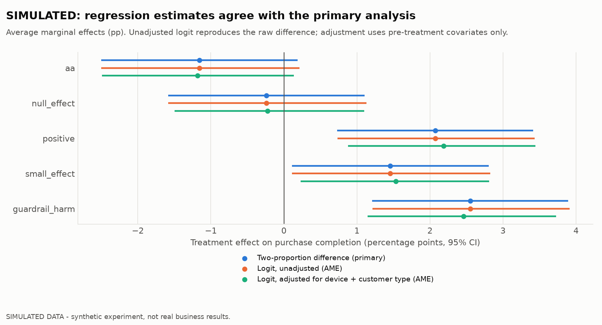
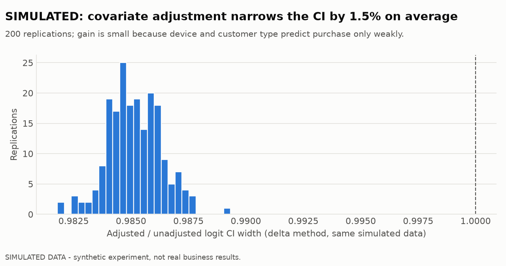
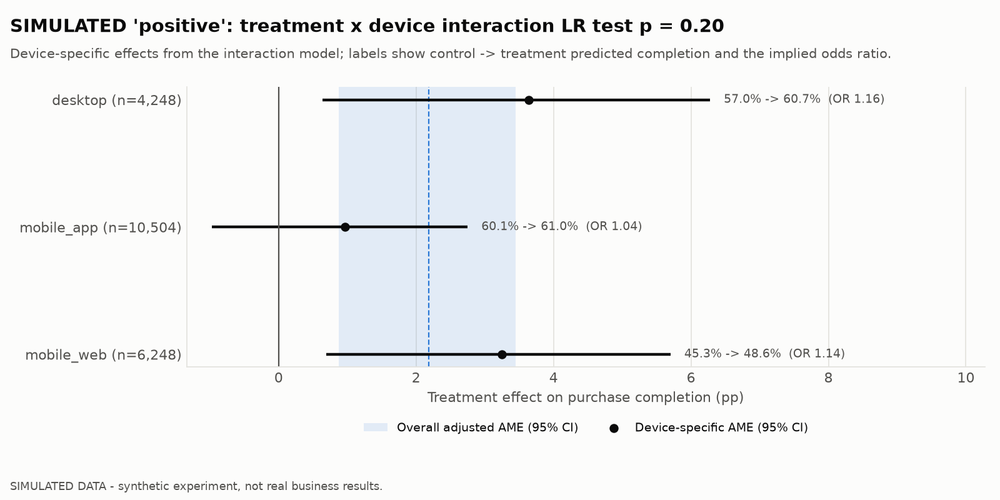
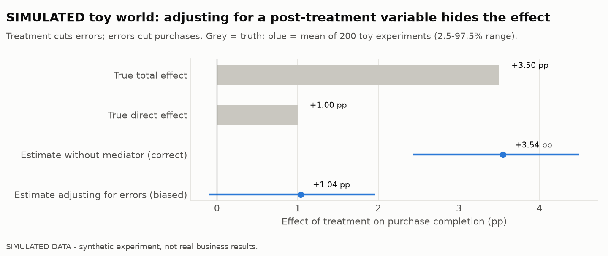

# Regression analysis of the checkout experiment (SIMULATED)

> ⚠️ **SIMULATED DATA. These are not business results.** This report analyses the same
> synthetic experiment as [experiment_findings.md](experiment_findings.md). It shows how
> a logistic regression complements, and must agree with, a randomised A/B analysis.
> The regression is a **secondary analysis added after the primary results were known**.
> It does not change any decision.
>
> **Reproduce:** `uv run python -m marketplace_analytics experiment` then
> `uv run python -m marketplace_analytics experiment-regression`. Tables are in
> `reports/results/experiment_regression/` and `sim.regression_*`, and charts are in
> `reports/figures/experiment_regression/`.

## 1. Models

| Model | Formula | Why |
|---|---|---|
| Unadjusted | `purchased ~ treatment` | Saturated, so its marginal effect must equal the raw difference |
| Adjusted | `purchased ~ treatment + device + customer_type` | Pre-treatment covariates can only improve precision |
| Interaction | `purchased ~ treatment × device + customer_type` | Does the effect differ by device (pre-registered segment)? |

- **Reference levels:** `mobile_app` and `returning`.
- **Fit:** logistic regression (binomial GLM) with HC1 robust standard errors. The
  simulation adds a fixed number of pp, so a logit is only an approximation.
- **Treatment effect:** reported as a conditional odds ratio and as an **average
  marginal effect (AME)**: the mean change in predicted purchase probability when
  every user is switched from control to treatment, in percentage points. AME
  intervals use the delta method.

**Not used as covariates:** checkout errors, checkout time, order value and
cancellations. They are measured after assignment and can be changed by the treatment
(§4).

## 2. Treatment effect: regression vs primary analysis

| Scenario | Raw difference (primary) | Unadjusted logit AME | Adjusted logit AME (95% CI) | Adjusted odds ratio (95% CI) | p |
|---|---|---|---|---|---:|
| `aa` | −1.16 pp | −1.16 pp | −1.18 pp (−2.51 to +0.14) | 0.95 (0.90–1.01) | 0.080 |
| `null_effect` | −0.24 pp | −0.24 pp | −0.22 pp (−1.55 to +1.10) | 0.99 (0.94–1.05) | 0.74 |
| `positive` | +2.07 pp | +2.07 pp | **+2.19 pp (+0.86 to +3.51)** | 1.10 (1.04–1.16) | 0.0012 |
| `small_effect` | +1.46 pp | +1.46 pp | +1.53 pp (+0.21 to +2.86) | 1.07 (1.01–1.13) | 0.023 |
| `guardrail_harm` | +2.55 pp | +2.55 pp | +2.46 pp (+1.14 to +3.78) | 1.11 (1.05–1.17) | 0.0003 |

- **Exact agreement.** In every scenario the unadjusted logit's AME equals the
  two-proportion difference to within 10⁻⁹. The pipeline fails if it does not. The two
  analyses measure the same thing.
- **Adjustment barely moves the estimate** (by at most 0.12 pp) and does not change
  which scenarios are significant. That is what randomisation predicts: device and
  customer type are balanced between arms, so adjusting for them cannot change what is
  being estimated.
- **Precision gain is real but small.** Comparing both logits with the same
  (delta-method) interval, adjustment narrows the 95% CI by **1.5% on average**
  (200 replications; 99% of ratios between 0.982 and 0.988). Device and customer type shift baseline
  completion (mobile web OR 0.57 vs app; new customers OR 0.60 vs returning) but explain
  little of the individual-level variance. A covariate such as **pre-period purchase
  history** (the CUPED idea) would be needed for a meaningful gain.

### Odds ratios are not percentage points

The adjusted `positive` model reports OR **1.10**. That does **not** mean "+10%
purchases", and it does not mean "+10 pp". It multiplies the *odds* p/(1−p). In this
data that corresponds to **+2.2 pp** on a base of about 55%, a **+4% relative**
increase. The same odds ratio implies a different pp change at a different baseline,
so product decisions should use the AME.

## 3. Does the effect differ by device?

A likelihood-ratio test compares the interaction model with the adjusted model
(2 df):

| Scenario | LR statistic | p |
|---|---:|---:|
| `aa` | 2.44 | 0.30 |
| `null_effect` | 5.37 | 0.068 |
| `positive` | 3.18 | 0.20 |
| `small_effect` | 0.30 | 0.86 |
| `guardrail_harm` | 2.72 | 0.26 |

**No scenario shows significant heterogeneity, which is correct: the simulated
effect is identical on every device.** The device-specific estimates still *look*
different. In `positive`, desktop is +3.6 pp and mobile_web +3.3 pp, while mobile_app
is +1.0 pp (CI −1.0 to +2.8). In the **A/A** test, desktop shows −3.2 pp with a CI
that excludes zero, although no effect exists at all. Read one by one, these would
suggest "the app version doesn't work" or "desktop is harmed". The single pre-planned
interaction test is the guard against that.

Two pitfalls:

- **The `treatment` coefficient changes meaning in the interaction model.** There it is
  the effect in the reference device (mobile_app): OR 1.04, p = 0.31 in `positive`. It
  is **not** "the treatment stopped being significant". The overall AME from the same
  model is still +2.19 pp.
- **Heterogeneity depends on the scale.** A constant +2.5 pp is a slightly different
  odds ratio at a 45% baseline (mobile_web) than at a 60% baseline (app). Any claim of
  heterogeneity should say whether it refers to pp or odds.

In `small_effect`, the reference-device treatment term in the interaction model has
p = 0.0495. One borderline term among several, with a non-significant overall
interaction test (p = 0.86), is noise, not a finding.

## 4. Why post-treatment variables must not be adjusted for

In the main simulation, checkout errors happen not to influence purchases, so adjusting
for them would do little harm *there*. Real checkouts are different, so this is shown
in a **separate toy simulation** (`mediator_bias_demo`) where the simplified checkout
works partly by preventing errors:

- **Data-generating process:** error ~ Bernoulli(0.15 − 0.10·T); purchase ~
  Bernoulli(0.55 + 0.01·T − 0.25·error).
- **Truth:** total effect +3.5 pp (direct +1.0 pp, plus +2.5 pp through fewer errors).

| Over 200 toy experiments of 40,000 users | Mean estimate | 2.5–97.5% range |
|---|---:|---|
| Without the mediator (correct total effect) | **+3.54 pp** | +2.42 to +4.49 |
| "Controlling" for checkout errors | **+1.04 pp** | −0.10 to +1.96 |

Adjusting for errors removes the part of the effect that works through fewer errors.
The analyst would report about +1 pp for a change that actually delivers about
+3.5 pp, and in a typical-sized test might call it non-significant. The same logic
rules out adjusting for checkout time, order value or cancellations. Conditioning on
anything measured only for buyers, such as checkout time, also selects on the outcome
itself.

## 5. Validation of the adjusted estimator

The adjusted model was rerun on 200 fresh simulated experiments per scenario, using
observed data only, and scored against the truth with 99% tolerance intervals:

| Check | A/A | Positive (+2.5 pp) |
|---|---:|---:|
| Rejection rate (expected 5% / 95.4% power) | 4.5% ✔ | 94.0% ✔ |
| 95% CI coverage of the true effect | 95.5% ✔ | 94.0% ✔ |
| Mean bias of the AME | −0.05 pp | −0.04 pp |
| Adjusted / unadjusted CI width | 0.985 | 0.985 |

The adjusted estimator is unbiased and correctly calibrated even though the logit
does not exactly match how the simulation generates outcomes.

## 6. Conclusions

1. **The regression confirms the primary analysis. It adds no new decision.** The
   decisions in [experiment_findings.md](experiment_findings.md) stand: positive →
   LAUNCH, guardrail_harm → REJECT, null and small effect → CONTINUE TESTING.
2. **Pre-treatment adjustment is safe but buys little here** (about 1.5% narrower
   CIs). Better variance reduction needs covariates that predict purchase strongly,
   such as pre-period behaviour.
3. **Reject device-specific stories** without a significant, pre-planned interaction.
4. **Never adjust for variables the treatment can change.** It can hide most of a real
   effect.

## 7. Limitations

- **Synthetic data.** Covariates are only device and customer type, and effects are
  constant by construction.
- **Fixed-horizon, user-level analysis.** No sequential testing, clustering or
  interference.
- **The regression section was written after the primary results were seen.** It is
  framed as secondary for that reason.
