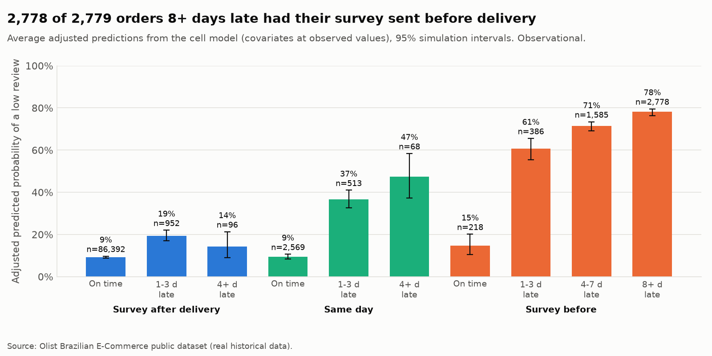
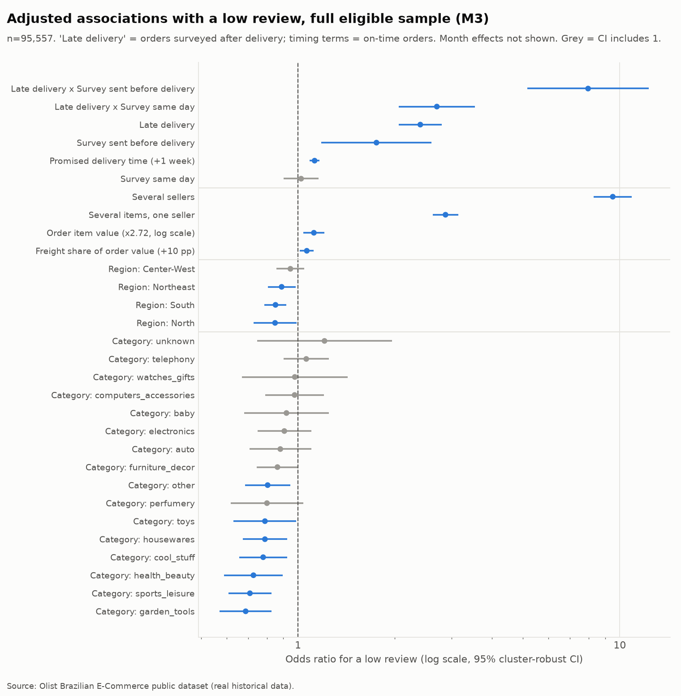
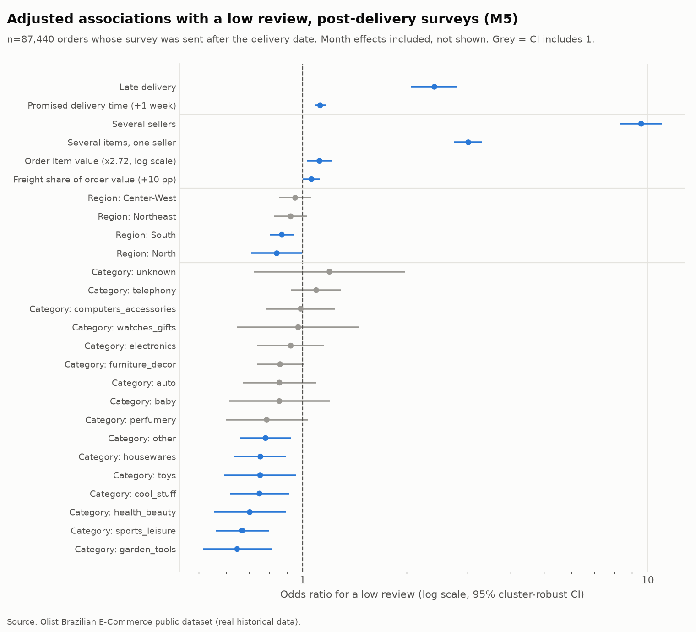
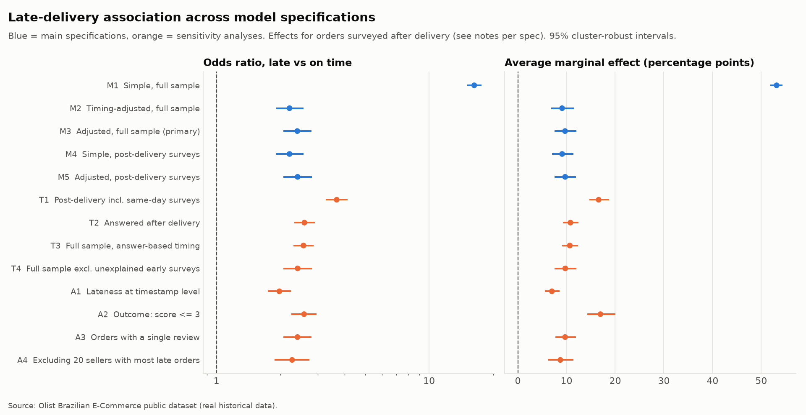
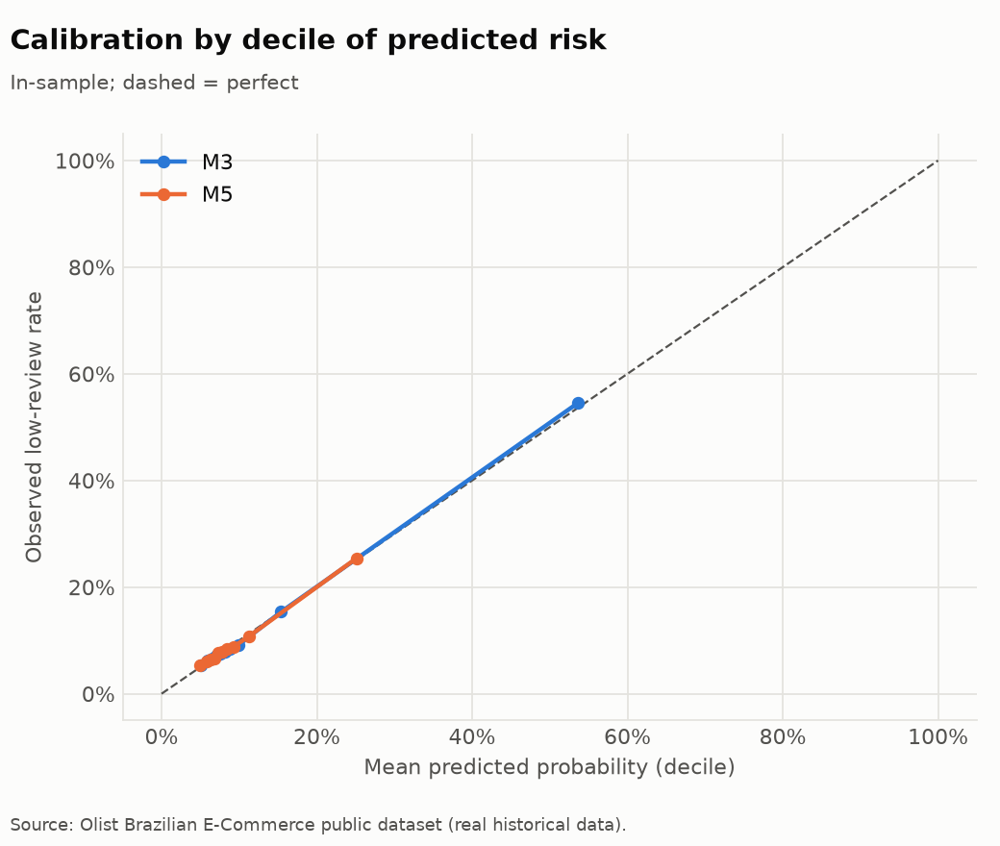

# What is associated with low reviews? (Olist, observational)

> **Scope.** Real Olist orders, purchased from Jan 2017 to Aug 2018. Every result is an
> **observational association**. Nothing here shows that changing a factor would
> change reviews.
>
> **Reproduce:** `uv run python -m marketplace_analytics regression`. Numbers come from
> `reports/results/regression/*.csv`, and charts are in `reports/figures/regression/`.
> Method details are in [docs/methodology.md](../docs/methodology.md#part-1-observational-regression-on-low-reviews-phase-b).

## 1. Bottom line

1. **The naive late-delivery gap is mostly a measurement artefact.** Unadjusted, late
   orders have 16× the odds of a low review (+53 percentage points). Most of that comes
   from customers who were surveyed, and often answered, **before the parcel arrived**.
2. **Among orders surveyed after delivery, lateness is still clearly associated with
   low reviews.** Adjusted OR **2.40** (95% CI 2.06–2.80): the predicted low-review
   rate rises by **+9.7 percentage points** (7.5–12.0), from a 9% baseline. Ten of the
   11 alternative specifications give an OR between 1.98 and 2.59. The exception is
   counting same-day surveys as post-delivery (OR 3.68).
3. **That estimate covers *mild* lateness only.** 2,778 of the 2,779 orders more than
   a week late had their survey sent before delivery. The data cannot say how customers
   rate a severely late order once it has arrived.
4. **The largest association after timing is basket structure.** Orders from several
   sellers have 9.6× the odds of a low review (+36 pp vs single-item orders), even
   though they are rarely recorded as late. A plausible explanation is partial or split
   deliveries that order-level timestamps cannot capture. That is a hypothesis to
   test, not a finding.
5. **Products, regions and order value matter far less** once these are held fixed
   (effects of a few percentage points or less).

## 2. Population

| Step | Remaining | Removed |
|---|---:|---:|
| Orders purchased in analysis window | 99,092 | |
| Delivered with a customer-delivery timestamp | 96,203 | 2,889 |
| Has a review (latest review per order) | 95,560 | 643 |
| Survey sent/answered on or after purchase | **95,557** | 3 |

No model variable has missing values in this population. 1,347 orders have products
without a category, which are kept as the level `unknown`. The low-review rate is
12.8% (12,226 orders).

How lateness and survey timing combine (orders, low-review rate):

| Survey timing | On time | 1–3 days late | 4–7 days late | 8+ days late |
|---|---|---|---|---|
| Sent after delivery date (`post`) | 86,392 (9.2%) | 952 (18.7%) | 95 (14.7%) | 1 |
| Sent on delivery date | 2,569 (9.1%) | 513 (36.3%) | 68 (45.6%) | 0 |
| Sent before delivery date (`pre`) | 218 (17.0%) | 386 (59.8%) | 1,585 (71.8%) | 2,778 (79.3%) |

## 3. Main results

### 3.1 How the late-delivery association changes

| Spec | Sample | Adjusted for | n | Late OR (95% CI) | AME, pp (95% CI) |
|---|---|---|---:|---|---|
| M1 | Full | none | 95,557 | 16.30 (15.10–17.61) | +53.2 (51.9–54.4) |
| M2 | Full | survey timing | 95,557 | 2.21 (1.90–2.56) | +9.1 (6.9–11.5) |
| **M3** | Full | timing + covariates | 95,557 | **2.40 (2.06–2.80)** | **+9.7 (7.5–12.0)** |
| M4 | Post-delivery surveys | none | 87,440 | 2.21 (1.90–2.56) | +9.1 (7.1–11.4) |
| **M5** | Post-delivery surveys | covariates | 87,440 | **2.41 (2.06–2.81)** | **+9.7 (7.6–12.0)** |

For M2/M3 the effect is averaged over the 87,440 orders surveyed after delivery, so M3
and M5 describe the same group.

- **Survey timing does almost all the work.** Moving from M1 to M2 cuts the OR from
  16.3 to 2.2.
- **The covariates barely move it** (2.21 → 2.40). Observed category, region, value,
  freight, basket, promise length and month do **not** explain the remaining
  association. That doesn't rule out unobserved confounders such as seller quality or
  carrier.
- Within M3, the late-vs-on-time OR is **6.5** (5.2–8.1) for same-day surveys and
  **19.1** (12.8–28.6) for pre-delivery surveys. Those comparisons mix lateness with
  "not yet received" and with a tiny, unexplained on-time pre-delivery group (218
  orders).

### 3.2 Adjusted associations (primary models)

Average marginal effects in M5 (post-delivery surveys, n = 87,440):

| Change | AME, pp (95% CI) | Odds ratio (95% CI) |
|---|---|---|
| Late vs on time | +9.7 (7.6–12.0) | 2.41 (2.06–2.81) |
| Several items, one seller vs single item | +12.2 (10.9–13.6) | 3.02 (2.75–3.32) |
| Several sellers vs single item | +35.9 (33.0–39.2) | 9.57 (8.32–11.00) |
| Promise one week longer | +1.0 (0.7–1.4) | 1.12 (1.08–1.17) |
| Item value doubled | +0.6 (0.2–1.2) | 1.12 per ×e (1.03–1.22) |
| Freight share +10 pp | +0.5 (0.0–0.9) | 1.06 (1.00–1.12) |

**Statistical vs practical significance.** Freight share, order value and promise
length are "significant" (p < 0.05) but move the probability by about 1 percentage
point or less. With roughly 90k orders, even trivial associations reach significance.
Lateness and basket structure are the factors that matter in practice.

**Categories** (vs bed_bath_table, the most common and among the worst-reviewed):
garden_tools (0.65), sports_leisure (0.67), health_beauty (0.70) and others show lower
odds, while telephony, computers_accessories and watches_gifts are not
distinguishable from the reference.

**Regions** (vs Southeast, M5): South (0.87) and North (0.84) are slightly lower. The
Northeast's raw disadvantage from the EDA disappears once lateness, promise length and
freight are held fixed (M5: 0.92, CI 0.83–1.03; M3: 0.89, CI 0.81–0.98). That is consistent with its worse raw reviews running through
delivery performance, but this design cannot show it.

## 4. Robustness and sensitivity

| Spec | Change | n | Late OR (95% CI) | AME, pp |
|---|---|---:|---|---:|
| T1 | Count same-day surveys as post-delivery | 90,590 | 3.68 (3.26–4.14) | +16.6 |
| T2 | Restrict by answer time, not survey date | 90,912 | 2.59 (2.32–2.90) | +10.8 |
| T3 | Full sample, answer-based timing | 95,557 | 2.56 (2.30–2.86) | +10.7 |
| T4 | Drop surveys sent before delivery *and* promise | 95,285 | 2.41 (2.07–2.81) | +9.7 |
| A1 | Late = delivered after promised date 00:00 | 95,557 | 1.98 (1.75–2.24) | +7.0 |
| A2 | Low review = score ≤ 3 | 95,557 | 2.58 (2.25–2.96) | +17.0 |
| A3 | Orders with a single review only | 95,034 | 2.40 (2.06–2.80) | +9.7 |
| A4 | Drop the 20 sellers with most late post-delivery orders | 76,217 | 2.27 (1.88–2.74) | +8.7 |

What the sensitivity analyses show:

- **The direction and rough size are robust.** No reasonable choice removes the
  association. For the score ≤ 2 outcome the AME stays between +7.0 and +10.8 pp,
  except T1.
- **The same-day boundary matters most (T1).** Same-day surveys of late orders include
  customers who answered before the parcel arrived (200 of the same-day surveys
  overall). This is why same-day is a separate class rather than being lumped into
  "post".
- **Definitions shift the number in predictable ways.** Timestamp lateness (A1) counts
  "delivered on the promised day" as late, which dilutes the contrast. A broader outcome
  (A2) raises the absolute effect because the baseline is higher.
- **No dependence on a few sellers (A4)** and no dependence on the latest-review rule
  (A3).

**Model-free cross-check (Cochran–Mantel–Haenszel), post-delivery surveys:**

| Stratified by | Pooled OR (95% CI) | Homogeneity p |
|---|---|---:|
| Region (5 strata) | 2.19 (1.87–2.57) | 0.41 |
| Month (19 usable strata) | 2.17 (1.85–2.54) | 0.29 |

These agree with the regression, and there is no evidence that the association differs
between regions or months. In the full sample stratified by survey timing, homogeneity
is rejected (p < 0.001). That matches §3.1: the late-vs-on-time association differs
sharply by timing, so a single pooled number for the full sample would be misleading.

**Fragility (influence diagnostic).** The post-delivery estimate rests on only **192
low reviews among 1,048 late orders**. The 1% most influential observations (956)
include 104 of those 192. Removing them drops the OR to 1.12 (0.91–1.39). That is not
a valid robustness test, because it deletes the association it is testing. It does
show that **precision is limited by the small number of late, post-delivery orders**,
not by the 95k total.

## 5. Model quality

| | M3 (full) | M5 (post-delivery) |
|---|---:|---:|
| Observations / low reviews | 95,557 / 12,226 | 87,440 / 8,167 |
| AUC (in-sample) | 0.742 | 0.642 |
| McFadden R² | 0.19 | 0.05 |
| Max VIF (excl. timing interaction terms) | 5.8 | 3.7 |

- **Calibration** is close to the diagonal in every decile.
- **Discrimination** is modest once the timing pathway is removed (AUC 0.64). Most of
  what drives a low review is not in the data. That is fine for estimating
  associations, but this model is not a useful predictor of individual reviews.
- **Clustered standard errors** are typically 1.2× the model-based ones (up to 3.4×),
  so ignoring seller clustering would overstate precision.

## 6. Limitations

- **Observational.** Late and on-time orders differ in ways not in the data (seller
  reliability, carrier, product condition, communication). The adjusted OR is an
  association conditional on observed factors, not the effect of making an order late.
- **Selection.** Only delivered orders whose customers answered a survey are modelled.
  Undelivered orders, whose reviews are mostly negative (EDA §2.5), are outside the
  population.
- **Post-delivery restriction.** This group is defined by a process influenced by
  lateness, and keeps only mild delays. It is cleaner for measurement, **not**
  unbiased, and does not generalise to severe delays.
- **Measurement.**
  - Delivery is recorded per order, so partial shipments are invisible.
  - The survey trigger rule is inferred.
  - Review dates are day-precision.
- **Dependence.** Repeat customers (about 3%) are not modelled as clusters.
- **Model form.** Effects are assumed additive on the log-odds scale apart from the
  late × timing interaction. Other interactions, such as lateness by region or by
  promise length, were not explored, because no specific rationale for them was set
  in advance.

## 7. Implications and next questions

- **For the business.**
  - Reliability matters more than speed: a longer promise costs about 1 pp, while
    breaking the promise costs about 10 pp.
  - Multi-seller orders are the clearest unexplained risk.
  - The review metric itself is affected by survey timing. Sending surveys only after
    confirmed delivery would make review scores a cleaner signal of the delivered
    experience. That is a measurement change to test, not a causal claim.
- **Further analysis:**
  1. Item- or shipment-level delivery data to test the partial-delivery explanation.
  2. Seller-level random effects.
  3. A real experiment, for example on survey timing or on delivery-promise accuracy,
     to estimate causal effects. Phase C shows the analysis framework on simulated
     data.
